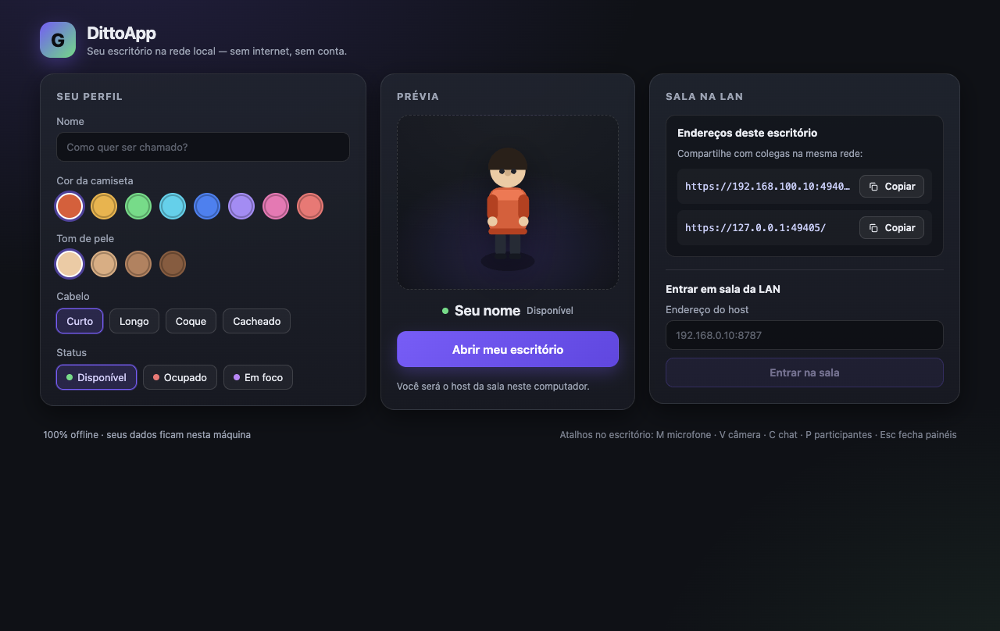
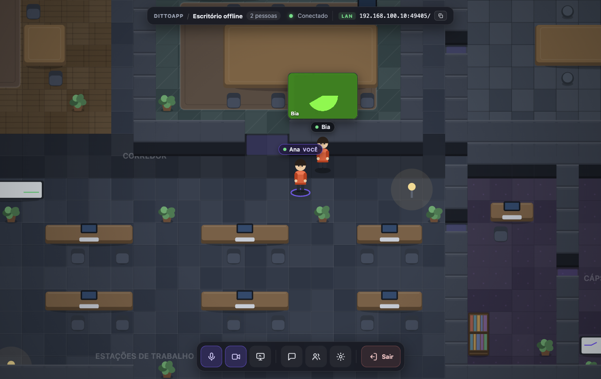
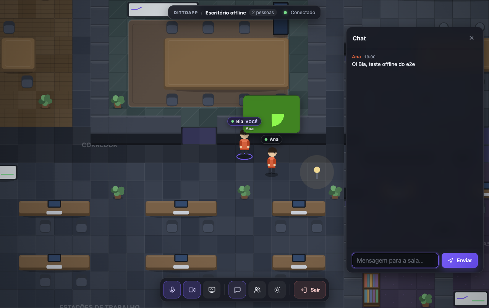
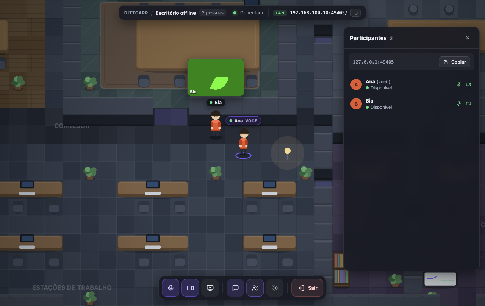
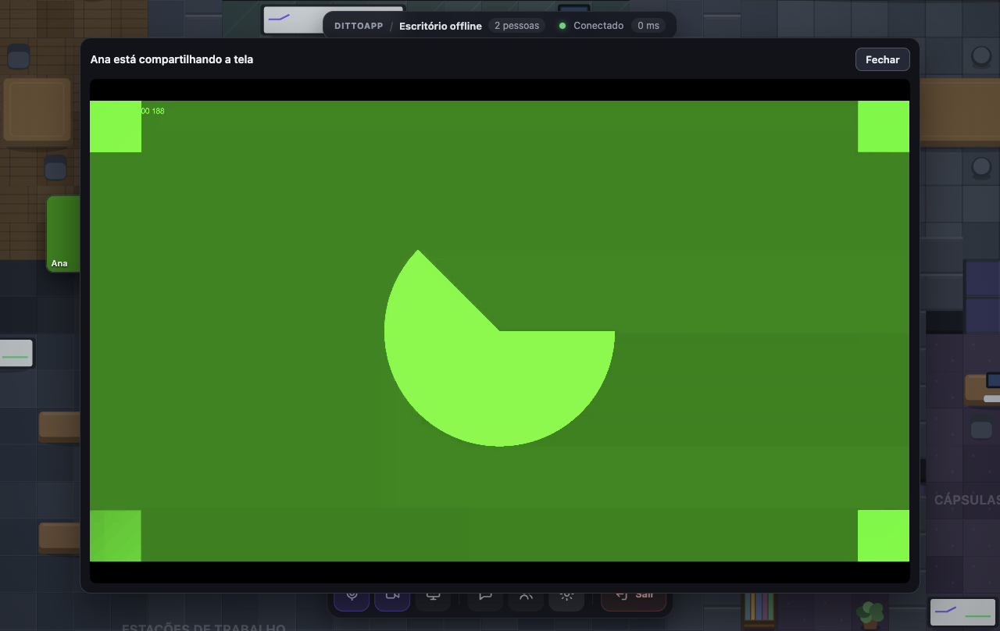

# Verificação — DittoApp

Status: **VERDE** (verificado em 2026-10-28). Este documento é o relatório reproduzível do que foi
testado, como, e com quais evidências — incluindo o que **não** foi coberto.

> **Rebrand M0 (2026-10-28):** todas as evidências abaixo foram revalidadas com a marca **DittoApp**
> (offline e2e 17/17, online 8/8 e DMG `DittoApp-1.0.0-arm64.dmg`); screenshots regenerados.

O app é um estudo de engenharia reversa independente, não afiliado à Gather Presence Inc.

## Ambiente da rodada

| Item | Valor |
|---|---|
| macOS | 27.0.1 (arm64) |
| Node / npm | v24.21.0 / 11.19.0 |
| Electron | 44.4.3 |
| playwright-core | 1.64.1 |
| LAN da máquina | `192.168.100.10` (interface privada usada no teste de endpoint LAN) |
| Sessão | gráfica (os apps abrem janela real; não é headless) |

## Comando único

```bash
cd Gat
npm install          # só na primeira vez
npm run build
npm run test:e2e     # sobe 2 instâncias Electron reais e roda a matriz abaixo
```

Complementos (também executados nesta verificação):

```bash
npm run typecheck    # tsc --noEmit
npm test             # 30 testes de unidade (node --test)
npm run dist         # electron-builder --mac --dir
```

`npm run test:e2e` já compila o app antes de rodar; `--no-build` reaproveita `dist/`.
O harness planeja o build, mata os apps e apaga o userData temporário mesmo em falha/exceção
(exit code ≠ 0 em qualquer check obrigatório vermelho).

## Resultado

Quatro execuções completas verdes nesta sessão (2026-10-28, ~17:44–17:50), sendo as **duas últimas
consecutivas** com a versão final do harness: **17/17 checks verdes, exit code 0** em ambas.

Saída resumida da última execução (portas dinâmicas, por isso variam a cada rodada):

```
✓ build e artefatos — npm run build ok
✓ duas instâncias Electron isoladas — host:64372 guest:64373 (userData temporário isolado)
✓ host: home → escritório — canvas ok, conectado como Ana
✓ guest: home → sala do host pelo fluxo LAN — carregou https://127.0.0.1:64372/?autojoin=1 como Bia
✓ ambos se veem (nome correto dos dois lados) — Ana ↔ Bia, data-testid player-* presentes
✓ mídia WebRTC: peers conectados e vídeo remoto — peers host=1 guest=1; video-tile remoto ok nas duas pontas
✓ movimento sincronizado (host anda, guest vê) — host 688→765px, guest vê 765px
✓ chat: host envia, guest recebe — "Oi Bia, teste offline do e2e" de Ana no chat do guest
✓ painel de participantes mostra os dois — Ana + Bia e endereço da sala
✓ painel de configurações lista dispositivos — 4 opções de microfone, 2 de câmera (fake devices)
✓ afastar jogadores encerra as conexões de mídia — distância 8.6 tiles (> 5.5), peers 0 nos dois
✓ screen share: host compartilha, guest vê o painel — getDisplayMedia real em 8647ms, vídeo 3600x2026 no guest, painel fechado corretamente
✓ endpoint HTTPS da LAN responde com cert self-signed — https://192.168.100.10:64372/ → 200, SAN com 192.168.100.10
✓ guest sai da sala e volta para a própria home — guest voltou para https://127.0.0.1:64373/, host com 1 jogador
✓ prova de offline: nenhum request externo, DNS bloqueado — 18 requests/eventos, 0 externos, 8 URLs privadas, DNS externo desabilitado
✓ offline-guard sem bloqueios e app fechando limpo — offline-guard.log vazio e total bloqueado=0 nas duas instâncias
✓ modo --offline-guard-strict sobrevive ao boot e à sala — boot + home + sala sem nenhum request externo (senão o app teria abortado)

17/17 checks obrigatórios verdes, 0 falha(s) — VEREDITO: VERDE
```

Outros comandos: `npm run typecheck` exit 0; `npm test` **30/30 testes passando, 0 falhas**;
`npm run dist` exit 0 gerando `release/mac-arm64/DittoApp.app` (≈308 MB, arm64, sem assinatura)
com `Contents/Resources/app.asar` contendo `dist/main`, `dist/client` e `package.json`.
Smoke do app empacotado (playwright-core, mesmo binário do `.app`): home abriu, escritório abriu e
conectou (`Packaged`, 1 jogador) — build de distribuição funcional, não só o `npm start`.

## Matriz de verificação

| # | O que | Como foi verificado | Resultado |
|---|---|---|---|
| 1 | Build (cliente + main/preload) | `npm run build` no início do e2e; presença de `dist/main/main.cjs`, `dist/main/preload.cjs`, `dist/client/index.html` | ✅ |
| 2 | Duas instâncias isoladas | 2 Electron com `GATHER_OFFLINE_USER_DATA` temporários distintos, `--multi-instance`, `--fake-media`, portas livres próprias | ✅ |
| 3 | Host: home → escritório | nome "Ana", `home-open-office`, `office-canvas` visível, `connection-status` = "Conectado", `office-self-name` = Ana; home anuncia `127.0.0.1:<porta>` e `192.168.100.10:<porta>` | ✅ |
| 4 | Guest entra pelo fluxo LAN da home | nome "Bia", endereço `127.0.0.1:<porta-do-host>`, `home-join-button`; janela passa a `https://127.0.0.1:<porta-do-host>/?autojoin=1` (mesmo caminho de um guest real: `joinLanRoom` → `normalizeJoinAddress`) | ✅ |
| 5 | Nomes e visibilidade mútua | hook read-only `window.__gatherTest()`: ids cruzados corretos, `players` = 2 dos dois lados; DOM `[data-testid="player-Bia"]` no host e `[data-testid="player-Ana"]` no guest | ✅ |
| 6 | Movimento sincronizado | host segura `d` por 700 ms → posição do host 688→765 px; guest vê 765 px (snapshots concorrentes, tolerância 6 px de skew de broadcast) | ✅ |
| 7 | Chat | host abre painel, envia "Oi Bia, teste offline do e2e"; guest recebe badge de não lidas, abre o painel e a mensagem aparece no DOM com autoria "Ana" | ✅ |
| 8 | Mídia WebRTC por proximidade | `mediaPeers` = 1 nas duas pontas, `mediaRemote` contém o id do outro, `video-tile` remoto com `videoWidth/videoHeight > 0` (frames reais do fake device) | ✅ |
| 9 | Histerese de proximidade | host anda para longe (8,6–10,6 tiles > raio de saída 5,5) → `mediaPeers` volta a 0 nas duas pontas | ✅ |
| 10 | Screen share | host clica `toolbar-screen` → `getDisplayMedia` **real** (handler `desktopCapturer` do shell; o fallback de canvas não foi usado); host com `screenSharing=true` + aviso de compartilhamento; guest sinaliza `screenSharing`, mostra `[data-testid="screen-share"]` e recebe frames ao vivo (track `displaySurface=monitor`, 3600×2026); parar fecha painel e derruba os peers. Os pixels no e2e são o padrão fake do Chromium porque o teste roda com `--fake-media` (ver limitações) | ✅ |
| 11 | Dispositivos | painel de configurações lista 4 opções de microfone e 2 de câmera (fake devices) | ✅ |
| 12 | LAN (endpoint TLS) | host anuncia `https://192.168.100.10:<porta>/`; GET do próprio teste via IP LAN retorna 200 com o cliente web, e o certificado self-signed tem SAN para o IP (`subjectaltname` inclui `192.168.100.10`) | ✅ |
| 13 | Leave do guest | guest clica `toolbar-leave` → volta para `https://127.0.0.1:<porta-própria>/` (home local), desconectado; host fica com 1 jogador | ✅ |
| 14 | Offline: nenhum request externo | captura de requests + WebSockets + `performance` entries dos dois pages; 18 eventos, 8 URLs únicas, **0 fora de loopback/rede privada**, nenhum `*.gather.town`; WSS loopback observado nas duas pontas | ✅ |
| 15 | Offline: DNS desabilitado | ambos Chromium com `--host-resolver-rules=MAP * ~NOTFOUND, EXCLUDE 127.0.0.1, EXCLUDE localhost`; todo hostname observado é IP privado literal — qualquer resolução externa falharia | ✅ |
| 16 | Offline guard do shell | `userData/logs/offline-guard.log` ausente/vazio e `[offline-guard] total bloqueado=0` no `main.log` das 3 instâncias | ✅ |
| 17 | `--offline-guard-strict` | 3ª instância com strict: sobrevive a boot + home + escritório (se um request externo ocorresse, o app abortaria); guard log vazio | ✅ |
| 18 | Screenshots | 6 PNGs regenerados a cada rodada (home, office, chat, participants, settings, screen-share) | ✅ |
| 19 | Unidade / tipos | `npm test` 30/30; `npm run typecheck` limpo | ✅ |
| 20 | Empacotamento | `npm run dist` exit 0; `.app` presente; asar com dist; smoke do binário empacotado conectou na sala | ✅ |
| 21 | Reconexão automática (queda de rede) | **não coberto** automaticamente — o cliente tem backoff/reconnect (`client/src/net/connection.ts`), mas o e2e não derruba o servidor no meio | ⚪ não coberto |

## Evidências

### Screenshots (gerados por `page.screenshot` a cada rodada)

| Arquivo | O que mostra |
|---|---|
| [`screenshots/home.png`](screenshots/home.png) | home do host com perfil, prévia e os endereços LAN (`https://192.168.100.10:<porta>/` e `https://127.0.0.1:<porta>/`) |
| [`screenshots/office.png`](screenshots/office.png) | escritório do host com os dois jogadores ("Ana você" e "Bia"), video-tile da câmera de Bia, topbar "2 pessoas · Conectado · LAN" |
| [`screenshots/chat.png`](screenshots/chat.png) | visão do guest com o painel de chat aberto, mensagem da Ana, video-tile remoto e self "Bia você" |
| [`screenshots/participants.png`](screenshots/participants.png) | painel de participantes do host: Ana + Bia e endereço da sala |
| [`screenshots/settings.png`](screenshots/settings.png) | painel de configurações do guest com dispositivos (fake devices) |
| [`screenshots/screen-share.png`](screenshots/screen-share.png) | guest vendo "Ana está compartilhando a tela" com o painel aberto e frames ao vivo (em `--fake-media` o conteúdo é o padrão de teste do Chromium; o pipeline é o real) |







### Logs e artefatos (`tests/e2e/artifacts/`, gitignored, regenerados a cada rodada)

| Arquivo | Conteúdo |
|---|---|
| `run.log` | transcrição completa da rodada (fases + resultado) |
| `requests.log` | todo request/websocket/entry de performance capturado, por instância |
| `host-main.log`, `guest-main.log`, `strict-main.log` | `main.log` de cada instância (boot, `localUrl`, carregamentos de janela, `[offline-guard] total bloqueado=0`) |
| `host-offline-guard.log`, `guest-offline-guard.log`, `strict-offline-guard.log` | vazios/ausentes = nenhum request bloqueado |

Trechos representativos da última rodada:

```text
# tests/e2e/artifacts/requests.log (todas as URLs; resumo)
guest  document   https://127.0.0.1:64372/?autojoin=1     # página servida pelo host
guest  script     https://127.0.0.1:64372/assets/index-*.js
guest  document   https://127.0.0.1:64373/                # volta para a home local após sair
guest  websocket  wss://127.0.0.1:64372/ws                # sala (WSS loopback)
host   script     https://127.0.0.1:64372/assets/index-*.js
host   websocket  wss://127.0.0.1:64372/ws
strict script     https://127.0.0.1:64398/assets/index-*.js
strict websocket  wss://127.0.0.1:64398/ws
# nenhuma URL fora de 127.0.0.1 / ::1 / rede privada; nenhum gather.town

# tests/e2e/artifacts/guest-main.log
[boot] localUrl=https://127.0.0.1:64373/ port=64373 mode=host
[window] carregado https://127.0.0.1:64372/?autojoin=1   # guest carregou o host
[window] carregado https://127.0.0.1:64373/              # leave voltou para a home local
[offline-guard] total bloqueado=0

# tests/e2e/artifacts/host-offline-guard.log
(ausente ou vazio: nenhum request bloqueado)
```

## Como a prova de offline foi feita

1. **Sem resolução DNS externa**: as duas instâncias sobem com
   `--host-resolver-rules=MAP * ~NOTFOUND, EXCLUDE 127.0.0.1, EXCLUDE localhost`. Se qualquer
   hostname externo fosse necessário, a conexão falharia; todos os hostnames observados são IPs
   privados literais.
2. **Sem requests externos**: o harness registra `request`, `websocket` e `performance entries` de
   cada página e falha se qualquer URL não for loopback/rede privada, ou se contiver `gather.town`.
   As únicas origens observadas são o próprio host (`https://127.0.0.1:<porta>/` e
   `wss://127.0.0.1:<porta>/ws`) e, no guest, a home local do próprio app.
3. **Guarda do shell**: o processo principal aborta `webRequest` fora de loopback/rede privada e
   registra em `userData/logs/offline-guard.log`. O e2e verifica que o arquivo está ausente/vazio e
   que `main.log` fecha com `[offline-guard] total bloqueado=0`.
4. **Modo estrito**: uma 3ª instância com `--offline-guard-strict` (que encerra o app no primeiro
   request externo) permanece viva após boot, home e sala — prova comportamental de que nada externo
   foi tentado nesse caminho.

## Modo online (web) — camada aditiva verificada após a rodada offline

Adicionado depois da verificação offline, sem mudar o comportamento Electron/LAN (regressão refeita:
17/17 verdes). Detalhes e passo a passo de deploy em [`ONLINE_DEPLOY.md`](ONLINE_DEPLOY.md).

| O que | Como | Resultado |
|---|---|---|
| Build do servidor web | `npm run build && node deploy/build-online.mjs` | ✅ |
| Sala única no navegador | `node deploy/verify-online.mjs` (2 contextos Chrome reais, devices fake) | ✅ 8/8: `/join` redireciona, `client-config.json`, 2 jogadores com nomes únicos, canvas, chat, WebRTC peers ≥ 1, nenhum request externo na página |
| Acesso público real | Cloudflare Quick Tunnel + 2 navegadores em contextos separados via `https://…trycloudflare.com/join` | ✅ 2 pessoas, chat e mídia WebRTC peers=1 pela internet ([screenshot](online/online-public.png)) |
| Regressão offline | `npm test` 30/30; `npm run test:e2e` 17/17 | ✅ |

## Limitações honestas (o que este veredito NÃO cobre)

- **Não são duas máquinas**: host e guest rodam na mesma máquina, com o guest usando o fluxo real de
  entrada da home (`joinLanRoom` → página do host). A alcançabilidade pela LAN foi provada
  parcialmente pelo GET em `https://192.168.100.10:<porta>/` (200 + SAN do IP no certificado), mas
  firewall de rede real, roteador/AP e uma segunda máquina não foram exercitados automaticamente.
- **Mídia com devices falsos**: áudio/vídeo usam `--fake-media` (devices fake do Chromium), não
  câmera/microfone reais. O e2e prova o pipeline WebRTC (signaling, tracks, frames), não a qualidade
  de hardware real; permissões de câmera/mic do macOS não foram testadas (fake-ui as dispensa).
- **Screen share**: nesta máquina o caminho **real** do shell abriu (`getDisplayMedia` via handler
  `desktopCapturer`, sem fallback) e os frames chegaram ao guest (track `displaySurface=monitor`,
  3600×2026). Porém o e2e roda com `--fake-media` e, com esse flag, o Chromium substitui o conteúdo
  capturado pelo seu padrão de teste — os frames são reais, os *pixels* não são o desktop do usuário.
  Um probe avulso **sem** `--fake-media` pelo mesmo handler capturou uma superfície real de janela
  (1280×840, pixels variados da UI), mas o fluxo interativo real do picker/permissão de gravação de
  tela do macOS não é automatizável e não foi validado automaticamente. O e2e valida: caminho real de
  `getDisplayMedia`, flag propagada, painel no guest, frames ao vivo e parada encerrando tudo. Em
  macOS/Electron onde o **system picker** nativo é usado, o harness tem fallback documentado (captura
  de canvas no contexto da página) e o registra explicitamente; nessa rodada ele não foi necessário.
- **Reconexão**: queda/retomada de rede no meio da sala não é exercitada pelo e2e; o cliente
  implementa reconexão com backoff, porém sem cobertura end-to-end nesta rodada.
- **Sem TURN/STUN**: a mídia é LAN-only por design; isolamento de clientes (AP isolation) pode
  impedir o P2P — comportamento documentado na arquitetura, não testável neste ambiente.
- **App empacotado**: foi feito smoke (abre, conectar) mas não uma rodada e2e completa contra o
  `.app`; assinatura/notarização não existem por escopo (estudo).
- O e2e exige sessão gráfica (não é headless) e leva ~45–60 s.

## Reprodutibilidade e limpeza

- Portas são escolhidas livres em tempo de execução; userData vai para `mkdtemp` por instância
  (`GATHER_OFFLINE_USER_DATA`), então rodadas não interferem entre si nem no perfil do usuário.
- Ao final (inclusive em falha/exceção): apps são fechados (`app.close()`, SIGKILL de segurança),
  diretórios temporários removidos e artefatos copiados para `tests/e2e/artifacts/`. Verificado
  `ps` sem processos órfãos e `$TMPDIR` sem `gather-e2e-*` após as rodadas.
- Checks opcionais (ex.: renderização de `video-tile`) entram como ⚠ aviso e não derrubam o veredito;
  checks obrigatórios vermelhos → exit code 1.
